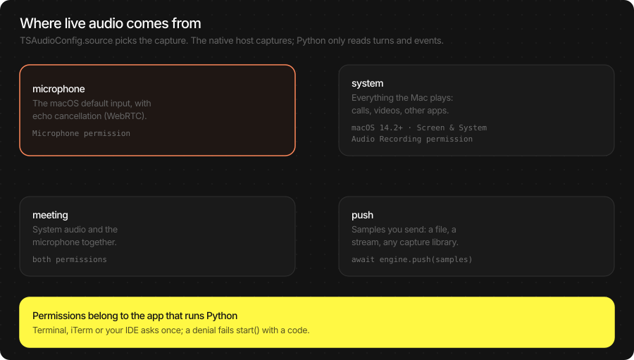

# Microphone and audio

[Docs home](README.md) · [Language models](llm.md) · [Vision](vlm.md) ·
[Speech recognition](asr.md) · [Text to speech](tts.md) · [Voice agent](voice_agent.md) ·
[Server](server.md)

Live speech (`ASREngine`, `TSVoiceAgent`) needs audio as it happens. The SDK can capture
it on the Mac itself, with echo cancellation, or you can send it samples from anywhere.
One setting picks which: `TSAudioConfig.source`.



## Audio format

| Direction | Format |
|---|---|
| Into the SDK (`ASRPipeline.infer`, `ASREngine.push`) | 1-D float32 samples in −1…1, mono. Any array-like; NumPy recommended. `infer` wants 16 kHz; `push` takes any rate you name |
| Out of the SDK (`TTSPipeline`, voice agent playback) | float32 NumPy array at the pipeline's `sample_rate` |
| Files | `await ts.decode_audio(data, sample_rate=16_000, format="m4a")` turns WAV, M4A/AAC, MP3, FLAC, CAF or AIFF bytes into mono float32 at `sample_rate` |

## `TSAudioConfig`

Every parameter, with its default:

```python
audio = ts.TSAudioConfig(
    source="microphone",            # "microphone" | "system" | "meeting" | "push"
    aec=None,                       # None = platform default (WebRTC) | "webrtc" | "vpio" | "neural" | "none"
    agc=None,                       # True: automatic gain on the microphone
    mute_mic_during_playback=None,  # voice agent: ignore the mic while it speaks
    aec_warmup_ms=None,             # voice agent: silence played first so the canceller converges (SDK: 250)
    sample_rate_out=None,           # voice agent: playback rate in Hz (SDK: 24000)
)
config = ts.TSAgentConfig(audio=audio)          # used by ASREngine.create and TSVoiceAgent.create
```

`None` keeps the SDK's value.

## Sources

| `source` | Captures | Needs |
|---|---|---|
| `microphone` | The macOS default input device | Microphone permission |
| `system` | Everything the Mac plays: calls, videos, other apps | macOS 14.2 or later, Screen & System Audio Recording permission |
| `meeting` | System audio and the microphone, mixed | Both permissions |
| `push` | Samples you send with `await engine.push(samples, sample_rate)` | Nothing |

Typical uses: `microphone` for dictation and the voice agent; `system` to caption a video
or the other side of a call; `meeting` for meeting notes (you and them); `push` for files,
network streams or a microphone you open yourself.

### Which microphone

`source="microphone"` uses the **default input** in System Settings → Sound → Input (or
the Sound menu in the menu bar). Change it there and the next `start()` uses it. The SDK
has no device argument; to use a device other than the default from code, open it
yourself and push ([below](#your-own-capture-push)).

### Permissions

macOS asks the **app that runs Python** (Terminal, iTerm, VS Code, PyCharm), not Python
itself. The first `start()` with `microphone`, `system` or `meeting` shows the prompt.

| Failure | `SDKError.code` | Fix |
|---|---|---|
| Microphone denied | `AUDIO_CAPTURE_PERMISSION_DENIED` | System Settings → Privacy & Security → Microphone → enable your terminal or IDE |
| System audio denied | `AUDIO_CAPTURE_PERMISSION_DENIED` | System Settings → Privacy & Security → Screen & System Audio Recording → enable it |
| macOS older than 14.2 (`system`, `meeting`) | `AUDIO_CAPTURE_UNSUPPORTED` | Use `microphone` or `push` |

```python
try:
    await engine.start()
except ts.SDKError as error:
    if error.code == "AUDIO_CAPTURE_PERMISSION_DENIED":
        print("Allow microphone access for this terminal in System Settings, then rerun.")
        raise
```

To see the prompt again after denying it: `tccutil reset Microphone` (all apps) and
restart the terminal.

## Echo cancellation

With speakers on, the microphone hears the Mac's own output. The canceller removes it, so
the voice agent can be interrupted while it talks and dictation does not transcribe a
video playing in the background.

| `aec` | What it is | When |
|---|---|---|
| `None` | The platform default: WebRTC on macOS | Almost always |
| `"webrtc"` | Software canceller using what the SDK plays as reference | Default; works with any output device |
| `"vpio"` | Apple's voice processing (as in FaceTime) | Compare on your hardware |
| `"neural"` | A neural canceller model | Compare on your hardware; more compute |
| `"none"` | Off | Headphones, or `system` / `meeting` capture |

`system` and `meeting` run without a canceller (the remote voices are what you want), so
`aec` there must be `None` or `"none"`. Speakers without a usable canceller in the voice
agent: `mute_mic_during_playback=True` (the agent cannot be interrupted by voice while
it speaks).

## Your own capture (push)

`source="push"` turns capture off; the engine transcribes what you send. Send mono
float32 about 100 ms at a time, at real-time pace; any sample rate (the engine resamples).

**A specific microphone with [sounddevice](https://python-sounddevice.readthedocs.io/)**
(`pip install sounddevice`):

```python
import asyncio
import sounddevice as sd
import thestage_sdk as ts

print(sd.query_devices())                     # find the device's name or index
DEVICE = "MacBook Pro Microphone"             # or an index from the list

engine = await ts.ASREngine.create(ts.TSAgentConfig(audio=ts.TSAudioConfig(source="push")))
turns = await engine.turns()                  # subscribe before start
await engine.start()

loop = asyncio.get_running_loop()
blocks: asyncio.Queue = asyncio.Queue()

def on_audio(indata, frames, time, status):   # sounddevice's thread
    loop.call_soon_threadsafe(blocks.put_nowait, indata[:, 0].copy())

async def pump():
    while True:
        await engine.push(await blocks.get(), sample_rate=16_000)

with sd.InputStream(device=DEVICE, channels=1, samplerate=16_000, dtype="float32",
                    blocksize=1_600, callback=on_audio):
    pumping = asyncio.create_task(pump())
    async for turn in turns:
        print(turn.committed, turn.hypothesis, "⏎" if turn.end_of_turn else "")
```

**A file, as if it were live** (tests, demos):

```python
audio = await ts.decode_audio(open("meeting.m4a", "rb").read(), sample_rate=16_000,
                              format="m4a")
for i in range(0, len(audio), 1_600):         # 100 ms blocks
    await engine.push(audio[i : i + 1_600], sample_rate=16_000)
    await asyncio.sleep(0.1)                  # real-time pace
```

Push gets no echo cancellation; use headphones or a canceller of your own when you also
play audio.

## Playing audio from Python

The voice agent plays through the default output device itself. For `TTSPipeline`
output, play or save the arrays yourself:

```python
import sounddevice as sd

result = await tts.infer("Hello from your Mac.")
sd.play(result.samples, result.sample_rate)
sd.wait()

# Streamed: start playing the first sentence while the rest is synthesized
stream = await tts.open_stream()
with sd.OutputStream(samplerate=stream.sample_rate, channels=1, dtype="float32") as out:
    await stream.send("First sentence. ")
    await stream.send("Second sentence.")
    await stream.close()
    async for chunk in stream:
        await asyncio.to_thread(out.write, chunk)   # blocking write, off the event loop
```

```python
import wave
import numpy as np

with wave.open("hello.wav", "wb") as f:          # 16-bit WAV, no extra packages
    f.setnchannels(1)
    f.setsampwidth(2)
    f.setframerate(result.sample_rate)
    f.writeframes((np.clip(result.samples, -1, 1) * 32767).astype("<i2").tobytes())
```

## Runnable examples

- [`examples/asr_engine_live.py`](../examples/asr_engine_live.py): `--source microphone|system|meeting`, `--aec …`, or a WAV pushed at real time
- [`examples/mic_push.py`](../examples/mic_push.py): pick a microphone by name and push it
- [`examples/tts_play.py`](../examples/tts_play.py): speak streamed text through the speakers
