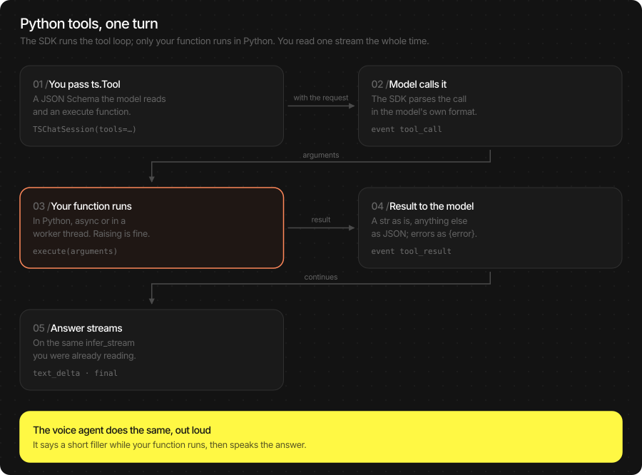

# Language models, chat and tools

[Docs home](README.md) · [Vision](vlm.md) · [Speech recognition](asr.md) ·
[Microphone and audio](audio.md) · [Text to speech](tts.md) · [Voice agent](voice_agent.md) ·
[Server](server.md)

Four ways to talk to a language model, from the simplest:

| You want | Use |
|---|---|
| One prompt, the whole reply | `await llm.infer(prompt)` |
| One prompt, tokens as they decode | `async for chunk in llm.infer_stream(prompt)` |
| A conversation the SDK remembers, tools it runs for you | `TSChatSession(llm, tools=[…])` |
| A conversation you keep yourself (OpenAI-style), tools you run yourself | `llm.infer_events(messages, tools=…)` |

## Load a model

```python
import thestage_sdk as ts

await ts.initialize(api_token="your-api-token")
llm = await ts.TSLLM.load(
    "TheStageAI/Qwen3-0.6B",   # engines_path: a TheStageAI repo id
    model_name="chat",         # the name to unload it by; default: the repo id
    device="npu",              # "npu" (Neural Engine, default), "gpu" or "cpu"
)
llm.model_name                 # "chat"
llm.generation_defaults        # dict: the model's own decoding settings
...
await ts.stop_model("chat")    # free its memory
```

The first load downloads the model and prepares it for this Mac; later loads are local
and take seconds.

## Generation settings (`config`)

Every call takes `config`, a dict that overrides `llm.generation_defaults` key by key.
Leave a key out to keep the model's value.

| Key | Type | Meaning |
|---|---|---|
| `max_new_tokens` | int | Upper bound on generated tokens |
| `min_new_tokens` | int | Tokens before a stop is allowed |
| `temperature` | float | `0` is greedy (same reply every time) |
| `top_k` | int | Sample from the k most likely tokens |
| `top_p` | float | Sample from the smallest set with this probability |
| `min_p` | float | Drop tokens below this fraction of the top one |
| `repetition_penalty` | float | `1.0` is off; higher discourages repeats |
| `seed` | int | Reproducible sampling |
| `enable_thinking` | bool | Reasoning models (Qwen3): think before answering |
| `stop_sequences` | list[str] | Stop when any of these is produced |
| `speculative_decoding` | bool | Use the model's draft model when it ships one |

```python
config = {"enable_thinking": False, "max_new_tokens": 256, "temperature": 0.7, "seed": 7}
```

## One prompt

**Whole reply.**

```python
result = await llm.infer(
    "Name three colours.",
    system_prompt="Answer in one line.",   # optional; default is the model's own
    config={"enable_thinking": False, "max_new_tokens": 32},
)
result.text                # "Red, green and blue."
result.prompt_tokens       # int
result.generated_tokens    # int
result.prefill_seconds     # time to read the prompt
result.decode_seconds      # time to write the reply
```

**Streamed.**

```python
async for chunk in llm.infer_stream(
    "Write a haiku about the sea.",
    system_prompt=None,
    config={"enable_thinking": False},
):
    if not chunk.is_final:
        print(chunk.text, end="", flush=True)
    else:                                  # the last chunk: metrics, no text
        print(f"\n{chunk.generated_tokens} tokens, {chunk.tokens_per_second:.0f} tok/s, "
              f"first token after {chunk.time_to_first_token:.2f} s, {chunk.stop_reason}")
```

`LLMStreamChunk`: `text`, `token_index`, `is_final`; on the final chunk also
`prompt_tokens`, `generated_tokens`, `tokens_per_second`, `time_to_first_token`
(seconds) and `stop_reason` (`eos`, `max_new_tokens` or `stop_sequence`).

`infer_stream(messages=[…])` takes a whole conversation instead of `prompt` (same message
format as [below](#a-conversation-you-keep-yourself)).

## Chat sessions

A `TSChatSession` keeps the conversation in the SDK: you send the next user message, the
session adds it to the history, keeps the system prompt in front and trims the oldest
turns when the model's context fills up.

```python
async with ts.TSChatSession(
    llm,
    system_prompt="You are a helpful assistant.",   # optional
    max_turns=8,                                    # optional: turns kept; default: the SDK's
    tools=None,                                     # optional: see "Tools" below
) as session:
    async for event in session.infer_stream("My name is Ada.", config={"enable_thinking": False}):
        if event.kind == "text_delta":
            print(event.text, end="", flush=True)
    reply = await session.infer("What is my name?")   # the whole reply as a str
```

Creating a session costs nothing; it opens in the SDK on the first call. Leaving the
`async with` block (or `await session.close()`) frees it. `llm.chat_session(...)` takes
the same arguments and returns the same object.

| Method | What it does |
|---|---|
| `infer_stream(user_request, config=None)` | Send a message, stream `LLMStreamEvent`s |
| `infer(user_request, config=None)` | Send a message, return the reply text |
| `history()` | `[{"role", "text", "parts", "name"}]`: the conversation so far |
| `clear()` | Forget the conversation; the system prompt stays |
| `cancel_in_flight()` | Stop the reply being generated; its stream ends |
| `close()` | Free the session; the next call starts an empty one |

**Events** (`LLMStreamEvent`: `kind`, `data`, and `event.text` for the deltas):

| `kind` | `data` |
|---|---|
| `text_delta` | `text`: the next piece of the answer |
| `thinking_delta` | `text`: reasoning, when `enable_thinking` is on |
| `tool_call` | `name`, `arguments` (dict): the model called a tool |
| `tool_result` | `name`, `content` (str): what the tool returned |
| `tool_round` | `assistant_raw`: the model's own text for the call |
| `final` | `stop_reason`, `prompt_tokens`, `generated_tokens`, `tokens_per_second`, `total_seconds`, `raw_text` |

**Stop a long answer.** Call `cancel_in_flight()` from another task, for example when the
user presses Esc:

```python
reply = asyncio.create_task(session.infer("Tell me a long story."))
await asyncio.sleep(2)
await session.cancel_in_flight()     # the reply's stream ends; the session stays usable
```

## Tools

A tool is a function the model may decide to call. You describe it with a
[JSON Schema](https://json-schema.org/understanding-json-schema/) and pass the Python
function that runs it. The session handles the round trip: the model calls, your function
runs, the result goes back to the model, and the answer arrives on the same stream.



```python
import datetime

async def get_weather(arguments: dict) -> dict:
    # arguments: what the model filled in, e.g. {"city": "Paris"}
    return {"city": arguments["city"], "temp_c": 17, "sky": "cloudy"}

def get_time(arguments: dict) -> str:        # a plain function works too
    return datetime.datetime.now().strftime("%H:%M")

tools = [
    ts.Tool(
        name="get_weather",
        description="Current weather for a city. Use it for any weather question.",
        parameters={
            "type": "object",
            "properties": {"city": {"type": "string", "description": "City name"}},
            "required": ["city"],
        },
        execute=get_weather,
    ),
    ts.Tool(
        name="get_time",
        description="The current local time.",
        parameters={"type": "object", "properties": {}},
        execute=get_time,
    ),
]

async with ts.TSChatSession(llm, tools=tools) as session:
    async for event in session.infer_stream(
        "What's the weather in Paris?", config={"enable_thinking": False}
    ):
        if event.kind == "tool_call":
            print(f"[calling {event.data['name']}({event.data['arguments']})]")
        elif event.kind == "tool_result":
            print(f"[{event.data['name']} returned {event.data['content']}]")
        elif event.kind == "text_delta":
            print(event.text, end="", flush=True)
```

```text
[calling get_weather({'city': 'Paris'})]
[get_weather returned {"city": "Paris", "temp_c": 17, "sky": "cloudy"}]
It's 17 °C and cloudy in Paris right now.
```

`ts.Tool` fields:

| Field | Type | Meaning |
|---|---|---|
| `name` | str | The name the model calls it by |
| `description` | str | When to use it. The model decides from this, so say it plainly |
| `parameters` | dict | JSON Schema of the arguments (`{"type": "object", "properties": …, "required": […]}`) |
| `execute` | callable or None | `(arguments: dict) -> str | dict | list`, plain or `async` |

How `execute` runs:

- An `async def` runs on your event loop. A plain function runs in a worker thread, so a
  blocking call (`requests.get`, a database query) does not freeze the stream.
- A `str` result goes to the model as is; anything else is sent as JSON.
- If it raises, the model receives `{"error": "<ExceptionType>: <message>"}` and usually
  tells the user what went wrong; the turn goes on. The same happens for a name the model
  made up.
- `execute=None` returns a placeholder result, handy for trying a prompt before the real
  function exists.

Tips: small models call tools more reliably with few, clearly described tools and
`"enable_thinking": False`; keep results short (a few fields, not a whole web page), since
they take room in the model's context.

The [voice agent](voice_agent.md#tools) takes the same `tools=[…]` and speaks the answer.

## A conversation you keep yourself

For servers and agent frameworks that hold the history themselves (the shape of the
OpenAI chat API), `infer_events` takes the whole conversation on every call. With
`tools`, a call the model makes comes back to you: run it, append the result, call
again.

```python
messages = [
    {"role": "system", "content": "Answer briefly."},
    {"role": "user", "content": "What is the weather in Paris?"},
]
tools = [{
    "name": "get_weather",
    "description": "Current weather for a city.",
    "parameters": {"type": "object", "properties": {"city": {"type": "string"}},
                   "required": ["city"]},
}]

while True:
    calls, raw = [], ""
    async for event in llm.infer_events(
        messages, tools=tools, system_prompt=None, config={"enable_thinking": False}
    ):
        if event.kind == "tool_call":
            calls.append(event.data)               # {"name", "arguments"}
        elif event.kind == "text_delta":
            print(event.text, end="", flush=True)
        elif event.kind == "final":
            raw = event.data["raw_text"]           # the model's own turn, verbatim
    if not calls:
        break
    messages.append({"role": "assistant", "content": raw})
    for call in calls:
        result = await get_weather(call["arguments"])
        messages.append({"role": "tool", "name": call["name"], "content": json.dumps(result)})
```

Message format: `{"role": "system" | "user" | "assistant" | "tool", "content": str}`, and
`"name"` on a `tool` message. Send the assistant turn back with `raw_text` from `final`
so the model sees its own call in its own format. The history is trimmed to the model's
context, oldest turns first. Without `tools`, the stream is `text_delta` events and
`final`.

## Thinking models

Qwen3 models think before answering when `enable_thinking` is on (their default). The
reasoning arrives as `thinking_delta` events (chat) and is not part of `text_delta`. Turn
it off for short, fast answers and for tool use with small models:
`config={"enable_thinking": False}`.

## Runnable examples

- [`examples/llm_stream.py`](../examples/llm_stream.py): streamed tokens and the final metrics
- [`examples/llm_chat.py`](../examples/llm_chat.py): a terminal chat with memory
- [`examples/llm_tools.py`](../examples/llm_tools.py): a chat that calls Python tools
