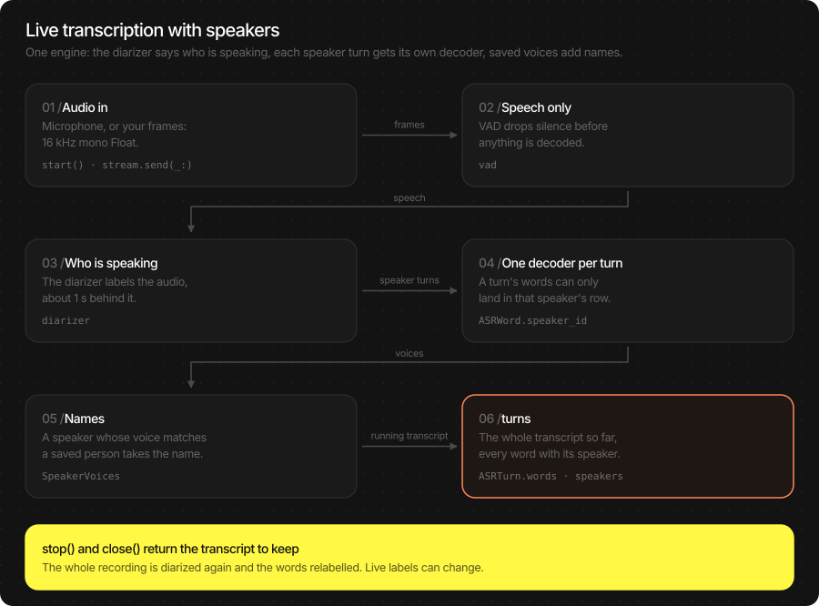

# Diarization (who said what)

Diarization tells you who spoke when. Add it to an ASR engine and every
word of the transcript carries its speaker; add saved voices and the
speakers carry the names of the people the user saved. Everything runs on
device — no audio and no voice sample leaves it.

Use it in two ways: hand over a recording and get speaker rows back, or
run a live session and watch the rows grow while people talk.

> **Main features**
>
> - **One engine for text and speakers**: `ASREngine(config:)` with
>   `speakers: .conversation(...)` serves a file, the microphone and
>   audio you send, by repo id.
> - **Live rows**: one decoder per speaker turn, so a speaker's words can
>   only land in that speaker's row.
> - **A corrected final transcript**: `stop()` and `close()` diarize
>   the whole recording again and relabel the words.
> - **Names from saved voices**: `SpeakerVoices` keeps people in one
>   JSON file; a speaker whose voice matches takes the name.
> - **Diarization on its own**: `NemotronDiarizationPipeline` gives
>   speaker segments without a transcript.

## In this page

Here we will cover the following topics:

- [Supported models](#supported-models): the diarizer and the speaker model.
- [Quick start](#quick-start): speakers on a file, on the microphone, on audio you send.
- [Speakers on a file](#speakers-on-a-file): one call, rows with speakers and names.
- [Speakers on a live stream](#speakers-on-a-live-stream): what arrives while people talk, and what `stop()` returns.
- [Speaker configuration](#speaker-configuration): `.conversation(...)` and every field behind it.
- [Diarization only](#diarization-only): speaker segments without ASR.
- [Result object](#result-object): speaker turns, speakers, segments and their fields.
- [Usage Guides](#usage-guides): a meeting recorder with names, naming a speaker after the meeting.
- [Troubleshooting](#troubleshooting): symptom → cause → fix.
- [Load Progress / Prefetch / Cleanup](#load-progress-prefetch-cleanup): warming the cache, releasing models.

## Supported models

| Model | HF repo | Role | Device | Fleet pin |
|---|---|---|---|---|
| Nemotron-3 Diarization | `TheStageAI/Nemotron-3-Diarization` | Who speaks when | pack default | v1.5 |
| Speaker ID v2 | `TheStageAI/speaker-id-v2` | Voice of a speaker, names | NPU | v1.6 |

| Capability | Nemotron-3 Diarization |
|---|---|
| Speakers at once | Up to 8 (`capabilities.max_speaker_slots`). More people share slots. |
| Whole file | yes (`infer`) |
| Live | yes (`open_stream`), latency `.LOW` (about 1 s behind the audio), `.VERY_LOW` or `.ULTRA_LOW` |
| Overlapping speech | yes — two speakers can be active at once |
| Input | 16 kHz mono Float in `[-1, 1]` |

Speakers work with every ASR family. A model that measures word times
(TheWhisper, Parakeet-TDT) also updates a speaker turn while it is
spoken; Qwen3-ASR transcribes each speaker turn as a whole once it ends.

## Quick start

Three ways to get speakers. They differ in who owns the audio.

| You want | Who owns audio | Use |
|---|---|---|
| Speaker rows for a recording | Nobody — you hand over samples | `engine.infer(audio:config:)` |
| Live rows from the microphone | **The SDK** | `engine.start()` / `engine.stop()` |
| Live rows from your own audio | **You** — push PCM frames | `engine.open_stream(...)` → `send` / `close()` |

All three use one engine:

**Swift**

```swift
import TheStageSDK

try await TheStageAI.shared.initialize(api_token: "your-api-token")

let engine = ASREngine(config: TSAgentConfig(
    vad: "TheStageAI/silero-vad",
    stt: "TheStageAI/thewhisper-large-v3-turbo",
    speakers: .conversation(
        // saved voices that name speakers; nil = no names
        voices: nil,
        // live only: relabel the whole recording at stop() / close()
        final_pass: true,
        diarizer: "TheStageAI/Nemotron-3-Diarization",
        speaker_model: "TheStageAI/speaker-id-v2"
    )
))

// A file: no start(); the models load on the first call
let samples = try AudioIO.load_wav(
    path: "/path/to/meeting.wav",
    target_sample_rate: 16_000
)
let result = try await engine.infer(
    audio: samples,
    config: ASRGenerationConfig(language: "en", timestamps: .WORD)
)
for row in result.speaker_turns {
    print(row.speaker_id, row.start, row.text)
}
```

**Flutter**

Speakers are not available on Flutter yet. `ASRWord.speaker_id`
is `null` there.

### Important API

| Purpose | Swift |
|---|---|
| Turn speakers on | `TSAgentConfig(vad:stt:speakers: .conversation(...))` |
| A file | `try await engine.infer(audio:config:)` → `ASRResult` with `speaker_turns`, `speakers`, `speaker_segments` |
| The microphone | `engine.turns.recv()`; `start()`; `stop()` → final `ASRResult?` |
| Your audio | `engine.open_stream(_:_:)` → `ASRStream`; `send(_:)`; `close()` → final `ASRResult` |
| Saved voices | `SpeakerVoices(file:speaker_model:)` — see [Speaker embedding](./speaker_embedding.md) |
| Change saved voices mid-session | `engine.update_enrolled_speakers(_:)` / `stream.update_enrolled_speakers(_:)` |
| Forget the session's speakers | `engine.reset_speakers()` / `stream.reset_speakers()` |

## Speakers on a file

One call returns the transcript as speaker rows. The whole file is
diarized at once, each speaker turn is transcribed on its own audio, and
speakers whose voice matches a saved person carry the name.

**Swift**

```swift
let voices = try SpeakerVoices(
    file: appSupport.appendingPathComponent("voices.json"),
    speaker_model: "TheStageAI/speaker-id-v2"
)
let engine = ASREngine(config: TSAgentConfig(
    vad: "TheStageAI/silero-vad",
    stt: "TheStageAI/thewhisper-large-v3-turbo",
    speakers: .conversation(voices: voices)
))

// 16 kHz mono Float in [-1, 1]
let result = try await engine.infer(
    audio: samples16k,
    config: ASRGenerationConfig(language: "en", timestamps: .WORD)
)

for row in result.speaker_turns {
    let speaker = result.speakers.first { $0.id == row.speaker_id }
    print("\(speaker?.name ?? row.speaker_id) \(row.start)s: \(row.text)")
}
```

**Flutter**

Not available on Flutter yet.

> [!TIP]
> - Each speaker turn is transcribed on its own. With
>   `language: "auto"`, a turn of 8 s or more detects its language and
>   a shorter one decodes without one — pass the language when you know
>   it.
> - A turn with less than `min_speech_s` (0.5 s) of speech is kept as
>   a row but not transcribed (`transcribed == false`).
> - `final_pass` has no effect on a file: the file is already
>   diarized whole.

## Speakers on a live stream



Live, the rows grow while people talk. The diarizer labels the audio
about 1 s behind it, each speaker turn gets its own decoder, and every
`ASRTurn` on `turns` is the whole transcript so far, each committed
word with its speaker. At the end, `stop()` (microphone) or
`close()` (your audio) returns the corrected transcript.

**Swift**

```swift
let engine = ASREngine(config: TSAgentConfig(
    vad: "TheStageAI/silero-vad",
    stt: "TheStageAI/thewhisper-large-v3-turbo",
    speakers: .conversation(voices: voices, final_pass: true)
))

// Rows from the running transcript: consecutive words of one speaker
func rows(_ words: [ASRWord]) -> [(speaker: String?, text: String)] {
    var out: [(speaker: String?, text: String)] = []
    for word in words where word.is_final {
        if let last = out.last, last.speaker == word.speaker_id {
            out[out.count - 1].text += " " + word.text
        } else {
            out.append((word.speaker_id, word.text))
        }
    }
    return out
}

// 1. The microphone. Open the reader before start(): a value sent
//    while nobody is receiving is dropped.
let live = Task {
    for await turn in engine.turns.recv() {
        // turn.speakers: the session's speakers with their names
        render(rows(turn.words), speakers: turn.speakers,
               live: turn.hypothesis)
    }
}
try await engine.start()
// ... the user taps Stop
let saved = await engine.stop()      // corrected; nil without speakers
live.cancel()

// 2. Audio you send: 16 kHz mono Float, any chunk size
let stream = try await engine.open_stream(
    ASRGenerationConfig(language: "auto", timestamps: .WORD)
)
let reader = Task {
    for await turn in stream.turns { render(rows(turn.words),
        speakers: turn.speakers, live: turn.hypothesis) }
}
for chunk in chunks16k { stream.send(chunk) }
let closed = await stream.close()    // corrected final result
await reader.value
```

**Flutter**

Not available on Flutter yet.

**What arrives** — on `engine.turns` / `stream.turns`:

| Field | Live with speakers |
|---|---|
| `words` | The whole transcript so far. Committed words (`is_final`) carry `speaker_id`; hypothesis words have `nil`. |
| `hypothesis` | The live guess of the turns still being spoken. |
| `speaker_id` | The main speaker of the latest turn. |
| `speakers` | Every speaker of the session, with `name` once a saved voice matches. |
| `speaker_revision` | Grows each time labels change on words already shown. The text does not change on a relabel; redraw the rows. |
| `language` | With `language: "auto"`: `nil` until the session language is known — see [ASR](./asr.md) (**Language**). Turns that ended before it are decoded again in it. |

**What** `stop()` **/** `close()` **return** — an `ASRResult` with
`speaker_turns`, `speakers` and `speaker_segments`. With
`final_pass` the whole recording is diarized again and runs of at
least 3 words and 1.2 s move to the speaker the pass found. Calling them
again returns the same result. `completion` is `.FAILED(_)` when
speaker processing failed. `stream.cancel()` ends a session you feed
without that correction and deletes the audio it kept.

> [!TIP]
> - Show the result of `stop()` / `close()` as the saved transcript,
>   not the last live value: labels can change at the end.
> - `final_pass` keeps the session's audio in a temporary file (about
>   115 MB an hour) until `stop()` / `close()`.
> - Each `open_stream` on this engine is its own session with its own
>   speakers; the models are shared.
> - `stop()` without a live session releases the models `infer`
>   loaded.

## Speaker configuration

`.conversation(...)` is the measured setup for conversations, meetings
and podcasts. It loads the models by repo id when the engine starts, or
on the first `infer`.

| Parameter | Default | What it does |
|---|---|---|
| `voices` | `nil` | Saved voices (`SpeakerVoices`) that name speakers. `nil` = labels only. |
| `final_pass` | `true` | Live only: at `stop()` / `close()`, diarize the whole recording again and relabel the words. |
| `diarizer` | `"TheStageAI/Nemotron-3-Diarization"` | The diarizer, repo id or local bundle. |
| `speaker_model` | `"TheStageAI/speaker-id-v2"` | The speaker model, loaded when `voices` or `final_pass` needs it. Without it, speakers are the diarizer's labels. |

What `.conversation` runs: the diarizer's labels are the speakers (a
voice only joins a returning speaker and names saved people), live
labels at latency `.LOW`, overlapping speech handed over to the
speaker who goes on, and a finished turn of up to 10 s decoded again
whole.

**Models you load yourself** — build the same setup from loaded
pipelines with `ASRSpeakerConfig.conversation(diarization:identification:enrolled:)`,
change any field, and set it on `TSAgentConfig.speakers` (it replaces
the `speakers:` setup of the initializer):

```swift
let diarizer = try await NemotronDiarizationPipeline(
    engines_path: "TheStageAI/Nemotron-3-Diarization"
)
let speaker_id = try await SpeakerIDPipeline(
    engines_path: "TheStageAI/speaker-id-v2"
)

// Every field, at the values .conversation(...) ships
var speakers = ASRSpeakerConfig(
    diarization: diarizer,
    identification: speaker_id,
    diarization_config: DiarizationConfig(mode: .CONTINUOUS, latency: .LOW),
    transcription: SpeakerTranscriptionConfig(
        overlap: .HANDOVER,
        redecode_turn_max_s: 10
    ),
    identity: SpeakerIDConfig(enrolled: voices.all, turn_identity: false),
    max_queued_audio_s: 60
)
speakers.transcription.final_pass = true

var config = TSAgentConfig(
    vad: "TheStageAI/silero-vad",
    stt: "TheStageAI/thewhisper-large-v3-turbo"
)
config.speakers = speakers
let engine = ASREngine(config: config)
```

`ASRSpeakerConfig`:

| Field | Default | Meaning |
|---|---|---|
| `diarization` | — | The loaded diarizer (`NemotronDiarizationPipeline`). |
| `identification` | `nil` | The loaded speaker model (`SpeakerIDPipeline`). `nil` = no names, speakers are the diarizer's labels. |
| `diarization_config` | `DiarizationConfig()` | The diarizer's settings (below). |
| `transcription` | `SpeakerTranscriptionConfig()` | How speaker turns are cut and decoded (below). |
| `identity` | `SpeakerIDConfig()` | Saved voices and the naming rule (below). |
| `max_queued_audio_s` | `60` | Seconds of live audio that may wait for speaker processing. Must be at least the diarizer's `max_pending_s` (27). |

`DiarizationConfig` — every override is `nil` = the pack's value.
Live sessions with speakers always run `.CONTINUOUS` without previews.

| Field | Default | Meaning |
|---|---|---|
| `threshold` | `nil` (0.5) | Activity a speaker needs to count as speaking. |
| `min_duration_on_s` | `nil` (0) | Shorter activity of a speaker is dropped. |
| `min_duration_off_s` | `nil` (0) | Shorter gaps inside one speaker's speech are filled. |
| `pad_onset_s` / `pad_offset_s` | `nil` (0) | Seconds added before / after each segment. |
| `mode` | `.ON_PAUSE` | Streaming: `.ON_PAUSE` commits labels at pauses (needs a VAD); `.CONTINUOUS` labels as audio arrives, at `latency`. |
| `latency` | `nil` (`.LOW`) | `.CONTINUOUS` only: `.LOW` (about 1 s), `.VERY_LOW`, `.ULTRA_LOW`. Lower is faster and flips labels more. |
| `commit_pause_s` | `nil` (0.8) | `.ON_PAUSE`: the pause that commits labels. |
| `max_pending_s` | `nil` (27) | The most audio kept uncommitted. |
| `pre_roll_s` | `nil` (0.24) | Audio kept before a pause-triggered step. |
| `emit_partials` | `false` | Provisional labels on `DiarizationStream.updates`. |
| `partial_interval_s` | `nil` (0.5) | How often those provisional labels arrive. |
| `reset_after_silence_s` | `600` | After this much silence the session starts new speakers. |

`SpeakerTranscriptionConfig` — how speaker turns become text.

| Field | Default | Meaning |
|---|---|---|
| `final_pass` | `false` (`.conversation`: `true`) | Live: diarize the whole recording again at `stop()` / `close()` and relabel the words. |
| `redecode_turn_max_s` | `nil` (`.conversation`: 10) | Live: a finished speaker turn up to this long is decoded again on its own audio, and that text replaces the live one. |
| `overlap` | `nil` (`.conversation`: `.HANDOVER`) | Live: who hears overlapping speech. `.CURRENT` the speaker already talking; `.BOTH` both; `.HANDOVER` both, and the previous speaker's audio ends where the next one goes on. `nil` = `.BOTH` under `THESTAGE_V5_5`, `.CURRENT` otherwise. |
| `warmup_relabel_at_s` | `[]` (off) | Live: session times at which all audio so far is diarized again and the words relabelled while the user watches. |
| `min_speech_s` | `0.5` | A speaker turn with less speech is not transcribed. |
| `transcribe_short` | `false` | `true` transcribes those short turns too. |
| `max_turn_s` | `28` | A longer speaker turn is split. |
| `max_interruption_s` | `1.0` | Another speaker talking longer than this ends the turn; shorter keeps it one turn. |
| `cut_pad_s` | `0.2` | Audio added around a speaker turn when it is cut out. |
| `cut_merge_gap_s` | `1.0` | Pieces of one speaker this close are decoded as one. |
| `join_silence_s` / `min_join_silence_s` / `seam_gap_s` | `0.5` / `0.2` / `1.5` | Silence put between joined pieces: `join_silence_s` when the gap was at least `seam_gap_s`, `min_join_silence_s` otherwise. |
| `short_turn_policy` | `.PRESERVE` | `.LEGACY_SMOOTHING` may give brief interjections to the surrounding speaker (with `min_segment_s` 0.25 and `min_sandwich_s` 1.0). |
| `asr_windowing` | `.QUIET_WINDOWS` | A turn longer than one ASR window is cut in its quiet places; `.PIPELINE_DEFAULT` uses the model's own windows. |
| `partial_interval_s` / `partial_min_speech_s` / `partial_active_window_s` | `1.0` / `1.0` / `0.5` | Models without measured word times: an open turn is decoded again every 1 s once it has 1 s of speech and was active in the last 0.5 s. |
| `text_source` | `.STREAM` | Set by the SDK from the model: `.STREAM` for models that measure word times, `.WINDOW_DECODE` otherwise. |

`SpeakerIDConfig` — naming. Scores are cosine similarities in
`[-1, 1]`.

| Field | Default | Meaning |
|---|---|---|
| `enrolled` | `[]` | Saved people (`[SpeakerProfile]`) that name speakers. `.conversation(voices:)` fills it from `voices.all`. |
| `identity_threshold` | `0.55` | A speaker without a name takes its best saved person at or above this score … |
| `identity_margin` | `0.10` | … when that person leads the second best by this much. |
| `identity_neg_threshold` | `0.35` | A speaker keeps its name while its score stays above this; below it the name is dropped. |
| `min_identity_speech_s` | `2.0` | Speech a speaker needs before it can join another speaker or take a name. |
| `min_embedding_speech_s` | `0.25` | The shortest clean piece of speech used as voice evidence. |
| `embedding_hop_s` | `1.0` | Hop between the voice windows of one piece. |
| `update_speech_s` | `2.0` | New speech between two identity checks of a speaker. |
| `rejoin_threshold` | `0.45` | A new label joins an earlier speaker whose voice scores at least this. |
| `drift_threshold` | `0.25` | New evidence scoring below this against the speaker's own voice is not added to it. |
| `return_embeddings` | `true` | `ASRSpeaker.embedding` is filled, so you can save a speaker (`SpeakerVoices.save`). |
| `turn_identity` | `true` (`.conversation`: `false`) | Live: a long speaker turn is checked on its own voice and can move to the speaker it matches. |
| `voice_change`, `split_rejoin_s`, `label_reseed_s`, `long_turn_merge`, `evidence` | `nil` (off) | Experimental live rules (split a label where the voice changes, merge two speakers a long turn shows are one person, …). Leave them off. |

> [!CAUTION]
> With `ASREngine(pipeline:vad:speakers:)`, leave `ASRStreamingConfig`
> empty except `format_turns`: speakers bring their own streaming
> policy, and other fields are refused (`INCOMPATIBLE_CONFIG`).

## Diarization only

Speaker segments without a transcript — for a timeline view, for
cutting a recording per speaker, or for your own ASR.

**Swift**

```swift
let diarizer = try await NemotronDiarizationPipeline(
    engines_path: "TheStageAI/Nemotron-3-Diarization"
)

// A file: 16 kHz mono Float
let activity = try await diarizer.infer(
    audio: samples16k,
    config: DiarizationConfig()
)
for segment in activity.segments {
    // "SPEAKER_00" … "SPEAKER_07"; overlapping segments are allowed
    print(segment.speaker_id, segment.start, segment.end)
}

// Live: append audio, read committed segments
let stream = try await diarizer.open_stream(
    config: DiarizationConfig(mode: .CONTINUOUS, latency: .LOW)
)
let reader = Task {
    for try await update in stream.updates {
        timeline.add(update.committed_segments)
    }
}
for chunk in chunks16k { try await stream.append(chunk) }
let whole = try await stream.finish()
await reader.value
```

**Flutter**

Not available on Flutter yet.

| Call | Use it to |
|---|---|
| `infer(audio:config:)` | Diarize a whole recording → `DiarizationResult`. |
| `open_stream(config:)` | Start a live session → `DiarizationStream`. |
| `append(_:)` | Push 16 kHz mono audio; returns once it is processed. |
| `updates` | `DiarizationUpdate` values: segments committed so far, and provisional ones with `emit_partials`. |
| `flush(through_sample:)` | Commit labels up to a sample you already sent (a pause you detected). |
| `reset_speakers()` | Forget the speakers; new speech gets new labels. |
| `finish()` | End the session → the final `DiarizationResult`. |
| `cancel()` | Abandon the session. |

> [!TIP]
> - One diarizer runs one session at a time. A second `infer` or
>   `open_stream` while one runs fails with `PIPELINE_BUSY`.
> - Labels are slots, not people: `SPEAKER_00` in one recording and in
>   the next are not the same person. Use saved voices for that.

## Result object

With speakers, `ASRResult` carries three more fields. Speaker ids are
opaque strings: `"speaker-0"`, `"speaker-1"`, … with the speaker
model, the diarizer's labels (`"SPEAKER_00"`, …) without it.

```swift
let result = try await engine.infer(audio: samples16k, config: generation)
result.speaker_turns   // [ASRSpeakerTurn] — one row per speaker turn
result.speakers        // [ASRSpeaker] — the session's speakers
result.speaker_segments // [SpeakerSegment] — when each speaker was active
result.words           // every word, each with speaker_id
result.completion      // .COMPLETE, .CANCELLED or .FAILED(_)
```

`ASRSpeakerTurn` — one row:

| Field | Meaning |
|---|---|
| `id` | The row's id. |
| `speaker_id` | Who spoke it. |
| `start` / `end` | Seconds from the start of the recording. |
| `text` | The row's text, formatted. |
| `words` | `[ASRWord]` with `t0` / `t1` on the recording's clock; `nil` with `timestamps: .NONE`. |
| `segments` | The `[SpeakerSegment]` the row was built from. |
| `timestamp_source` | `.MEASURED`, `.ESTIMATED` (a word spans a cut, or the model does not measure) or `.NONE`. |
| `transcribed` | `false` for a turn too short to transcribe (`min_speech_s`). |
| `is_final` / `revision` | Final rows never change; `revision` counts updates of a row. |

`ASRSpeaker` — one speaker of the session:

| Field | Meaning |
|---|---|
| `id` | The speaker id the words and rows use. |
| `name` / `identity_id` | The saved person this speaker matched, `nil` when none. |
| `identity_score` | Cosine score against that person. |
| `identity_status` | `.UNKNOWN`, `.PROVISIONAL` (not enough speech yet) or `.MATCHED`. |
| `embedding` | The speaker's voice (`SpeakerEmbeddingVector`), with `return_embeddings`. Pass the speaker to `SpeakerVoices.save` to keep it. |
| `speech_seconds` / `embedding_speech_seconds` | Speech heard from the speaker / speech behind the voice vector. |
| `identity_updated_at_s` / `revision` | When the name was last decided; a counter of updates. |

`SpeakerSegment`: `speaker_id`, `start`, `end` in seconds of the
recording. `DiarizationResult`: `segments`, `audio_seconds`,
`sample_rate`, `compute_seconds`.

**Speaker events** — `engine.speaker_events` / `stream.speaker_events`
deliver `ASRSpeakerEvent` values (`session_id`, `sequence`,
`payload`). Payloads: `DIARIZATION_UPDATED`, `TURNS_UPDATED`,
`SPEAKERS_UPDATED`, `SPEAKERS_MERGED`, `RESET`, `COMPLETED`,
`FAILED`, `CANCELLED`. Most apps read `turns` instead.

## Usage Guides

### A meeting recorder that names people

> **Problem**
>
> **Building** — a meeting recorder for a small team that records on
> one iPhone in the middle of the table.
>
> **Users want** — "Alex: …", "Maria: …" rows while they talk, the same
> names next week, and a transcript that is right when they open it
> after the meeting.
>
> **Hard part** — names must survive across sessions without storing
> audio, and the live labels must be fixed at the end without
> transcribing again.

**Solution — what to use**

- `SpeakerVoices(file:)` — one JSON file of saved people, read at
  launch.
- `.conversation(voices:final_pass: true)` — names live, corrected at
  the end.
- `engine.turns` — render rows from `turn.words`, names from
  `turn.speakers`.
- `engine.stop()` — store this result, not the live one.

**Swift**

```swift
let voices = try SpeakerVoices(
    file: appSupport.appendingPathComponent("voices.json")
)
let engine = ASREngine(config: TSAgentConfig(
    vad: "TheStageAI/silero-vad",
    stt: "TheStageAI/thewhisper-large-v3-turbo",
    speakers: .conversation(voices: voices, final_pass: true)
))

let live = Task {
    for await turn in engine.turns.recv() {
        let names = Dictionary(
            turn.speakers.map { ($0.id, $0.name ?? $0.id) },
            uniquingKeysWith: { a, _ in a }
        )
        meetingView.show(words: turn.words, names: names)
    }
}
try await engine.start()
// ... Stop
if let transcript = await engine.stop() {
    try store.save(transcript.speaker_turns, speakers: transcript.speakers)
}
live.cancel()
```

**Flutter**

Not available on Flutter yet.

> [!TIP]
> - A speaker takes a saved name at a score of 0.55 or more, 0.10 above
>   the next saved person, and keeps it while it stays above 0.35.
> - Up to 8 people speak at once on the shipped diarizer; more people
>   share labels.
> - Language: pass it if the meeting has one; `"auto"` settles on one
>   language over the first 10 s of speech.

### Name a speaker after the meeting

> **Problem**
>
> **Building** — the same recorder: a transcript shows "speaker-1",
> and the user taps it and types "Bob".
>
> **Users want** — Bob named in this transcript and recognised in the
> next meeting, without recording a sample.
>
> **Hard part** — the voice must come from the meeting itself, and the
> saved file must stay in one embedding space.

**Solution — what to use**

- `voices.save(speaker, id:name:)` — saves the voice the transcript
  found (`ASRSpeaker.embedding`).
- Rename the rows yourself for this transcript; the next session names
  Bob from the file.
- A session still running: `engine.update_enrolled_speakers(voices.all)`.

**Swift**

```swift
// transcript: the ASRResult stop() returned
if let bob = transcript.speakers.first(where: { $0.id == "speaker-1" }) {
    try voices.save(bob, id: "u7", name: "Bob")
}
// later sessions: SpeakerVoices(file:) reads Bob back
```

**Flutter**

Not available on Flutter yet.

> [!TIP]
> - `save` needs `ASRSpeaker.embedding`; it is there with the speaker
>   model and `return_embeddings` (both on in `.conversation`).
> - Saving the same person again adds a sample (up to 20); matching
>   uses their average.
> - Enrolment from a recording, renaming and removing:
>   [Speaker embedding](./speaker_embedding.md).

## Troubleshooting

| Symptom | Cause | Fix |
|---|---|---|
| No `speaker_turns` in the result | The engine has no speakers. | `TSAgentConfig(vad:stt:speakers: .conversation(...))`. |
| Live rows change at the end | `final_pass` relabelled the words. | Expected; store the result of `stop()` / `close()`. |
| No names | No `voices`, no match above 0.55, or less than 2 s of a speaker's speech so far. | Pass `voices`; save the person from a clean recording. |
| Two people share one speaker | Similar voices, or more than 8 at once. | Save both people; `final_pass` on. |
| `EMBEDDING_SPACE_MISMATCH` | A saved voice from another speaker model. | Keep one `speaker_model` per voices file. |
| `PIPELINE_BUSY` | A diarizer already runs a session. | One session per diarizer; finish or cancel it first. |
| `INCOMPATIBLE_CONFIG` at `open_stream` | A streaming field set on an engine built with `ASREngine(pipeline:vad:speakers:)`. | Leave `ASRStreamingConfig` empty except `format_turns`. |
| Short turns in other languages (file) | `"auto"` on a file with speakers detects per turn. | Pass the language. |

## Load Progress / Prefetch / Cleanup

`ASREngine(config:)` loads the diarizer and the speaker model when it
starts, or on the first `infer`. Warm the cache on a splash screen, and
release the engine's models with `stop()`.

```swift
let ai = TheStageAI.shared
_ = try await ai.prefetch_engines(repo_id: "TheStageAI/Nemotron-3-Diarization")
_ = try await ai.prefetch_engines(repo_id: "TheStageAI/speaker-id-v2")

// Progress, when you load the pipelines yourself
let diarizer = try await NemotronDiarizationPipeline(
    engines_path: "TheStageAI/Nemotron-3-Diarization",
    on_load_progress: { p in
        print("[\(p.model)] \(p.phase) \(Int(p.fraction * 100))%")
    }
)
```

Phases: `downloading` → `extracting` → `loading` → `ready`. Full
contract: [Get started](./README.md) (**Load Progress**).
