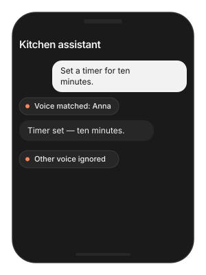
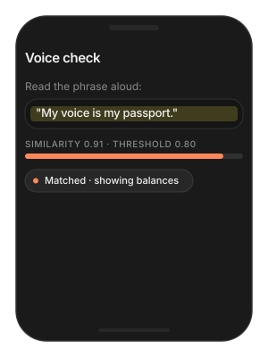

# Speaker embedding

Turns a few seconds of someone's voice into a fingerprint you can
compare. Enrol a person once, then tell who is speaking — on device,
without storing audio. In a transcript it gives speakers their names; in
the Voice Agent it lets the assistant respond only to its owner.

> **Main features**
>
> - **One vector per voice**: a unit-length embedding from 16 kHz audio;
>   192 values on the shipped models.
> - **One number to compare**: cosine similarity in `[-1, 1]`; you
>   choose the accept threshold.
> - **Store the vector, not the voice**: the vector is all you keep.
> - **Saved voices for transcripts**: `SpeakerVoices` keeps people in
>   one JSON file; speakers of a transcript that match take their names.
> - **Voice Agent integration**: enrol a speaker and the agent ignores
>   everyone else.

## In this page

Here we will cover the following topics:

- [Supported models](#supported-models): the two speaker models and which API uses which.
- [Quick start](#quick-start): verify a voice in one call.
- [Enroll and identify](#enroll-and-identify): `SpeakerIDPipeline`, saved voices, and how a speaker is named.
- [Usage Guides](#usage-guides): owner-only assistant, voice check at login.
- [Troubleshooting](#troubleshooting): symptom → cause → fix.

## Supported models

| Model | HF repo | Used by | Device | Fleet pin |
|---|---|---|---|---|
| Speaker ID v2 | `TheStageAI/speaker-id-v2` | `SpeakerIDPipeline`, `SpeakerVoices`, speakers in ASR ([Diarization](./diarization.md)) | NPU | v1.6 |
| ReDimNet2 | `TheStageAI/redimnet2` | `start_model` / `infer` (JSON), Voice Agent `speaker_id` | CPU | v1.4 |

> [!CAUTION]
> Vectors from two models are not comparable. A voice enrolled with
> `redimnet2` cannot be matched against `speaker-id-v2` speakers;
> the SDK refuses such a sample (`EMBEDDING_SPACE_MISMATCH`). Keep one
> model per store of voices.

## Quick start

Verify a voice in one call — the JSON path, Swift and Flutter.

**Swift**

```swift
try await TheStageAI.shared.start_model(
    model_name: "speaker_id",
    engines_path: "TheStageAI/redimnet2"
)

// 2 s of the user's voice
let pcm16k = try AudioIO.load_wav(
    path: enrolClipURL.path,
    target_sample_rate: 16_000
)
// Enrol: 2 s of the user's voice → 192-d vector
let enrolled = try TheStageAI.shared.infer(
    model_name: "speaker_id",
    input_json: ["audio": pcm16k]
)
let reference = enrolled[0]["embedding"] as! [Double]

let newPcm16k = try AudioIO.load_wav(
    path: checkClipURL.path,
    target_sample_rate: 16_000
)
// Verify: new audio + reference → similarity
let check = try TheStageAI.shared.infer(
    model_name: "speaker_id",
    input_json: ["audio": newPcm16k, "embedding": reference]
)
// accept if > 0.75
let similarity = check[0]["similarity"] as! Double
```

**Flutter**

```dart
await TheStageFlutterSDK.start_model(
  model_name: 'speaker_id',
  engines_path: 'TheStageAI/redimnet2',
);

// Enrol — pcm16k: Float32List, 16 kHz mono, 2 s (here a headerless float32 file)
final enrolBytes = await File('/path/to/enrol_16k.pcm').readAsBytes();
final pcm16k = Float32List.view(enrolBytes.buffer);
final enrolled = await TheStageFlutterSDK.infer(
  model_name: 'speaker_id',
  input_json: {'audio': pcm16k},
);
final reference = (enrolled[0]['embedding'] as List).cast<double>();

// Verify
final checkBytes = await File('/path/to/check_16k.pcm').readAsBytes();
final newPcm16k = Float32List.view(checkBytes.buffer);
final check = await TheStageFlutterSDK.infer(
  model_name: 'speaker_id',
  input_json: {'audio': newPcm16k, 'embedding': reference},
);
// accept if > 0.75
final similarity = check[0]['similarity'] as double;
```

### Important API

| Input / output | Meaning |
|---|---|
| `audio` | 16 kHz mono float, **2.0 s** (32 000 samples). Shorter is padded, longer is trimmed. |
| `embedding` (out) | `[Double]` of length 192, L2-normalised. Store this. |
| `embedding` (in) | A stored reference. When present, the call also returns… |
| `similarity` (out) | Cosine similarity between the fresh audio and the reference. |

Model: `TheStageAI/redimnet2`. Runs on CPU by default.

## Enroll and identify

Enrol a person from a recording of them, keep the voice in a file, and
let every transcript name them. `SpeakerIDPipeline` makes the vectors;
`SpeakerVoices` stores people; the speaker setup of an ASR engine does
the naming ([Diarization](./diarization.md)).

**Swift**

```swift
import TheStageSDK

try await TheStageAI.shared.initialize(api_token: "your-api-token")

// Saved voices: read if the file exists, created on the first change,
// written on every change, never leaves the device
let voices = try SpeakerVoices(
    file: appSupport.appendingPathComponent("voices.json"),
    // the model enroll loads (repo id or local bundle)
    speaker_model: "TheStageAI/speaker-id-v2"
)

// Enroll: a recording of one person, 16 kHz mono Float, a few seconds
try await voices.enroll(audio: alexSample16k, id: "u42", name: "Alex")

// Identify: speakers of a transcript take the names
let engine = ASREngine(config: TSAgentConfig(
    vad: "TheStageAI/silero-vad",
    stt: "TheStageAI/thewhisper-large-v3-turbo",
    speakers: .conversation(voices: voices)
))
let transcript = try await engine.infer(
    audio: meeting16k,
    config: ASRGenerationConfig(language: "en", timestamps: .WORD)
)
for speaker in transcript.speakers {
    print(speaker.id, speaker.name ?? "unknown", speaker.identity_score ?? 0)
}

// Save a speaker the transcript found, then manage people
try voices.save(transcript.speakers[1], id: "u7", name: "Bob")
try voices.rename(id: "u7", to: "Robert")
try voices.remove(id: "u7")
// [SpeakerProfile], sorted by name
let people = voices.all

// The vectors themselves
let speaker_id = try await SpeakerIDPipeline(
    engines_path: "TheStageAI/speaker-id-v2"
)
let voice = try await speaker_id.infer(audio: clip16k)
// voice.embedding.values: [Float], unit length,
// speaker_id.embedding_dimension long; voice.speech_seconds
let profile = try await speaker_id.enroll(
    audio: clip16k, id: "u42", name: "Alex"
)
```

**Flutter**

`SpeakerIDPipeline` and `SpeakerVoices` are not available on
Flutter yet. Use the JSON path in Quick start.

**Identify a clip yourself** — score it against each saved person with
the same rule a transcript uses:

```swift
// Both sides are unit vectors: the dot product is the cosine.
func cosine(_ a: [Float], _ b: [Float]) -> Double {
    zip(a, b).reduce(0) { $0 + Double($1.0) * Double($1.1) }
}
// A person is matched by the direction of their samples' average
// (the SDK also weights each sample by its speech, up to 30 s).
func anchor(_ person: SpeakerProfile) -> [Float] {
    var sum = [Float](repeating: 0, count: person.embeddings[0].values.count)
    for sample in person.embeddings {
        for i in sum.indices { sum[i] += sample.values[i] }
    }
    let norm = sqrt(sum.reduce(0) { $0 + $1 * $1 })
    return sum.map { $0 / norm }
}

let clip = try await speaker_id.infer(audio: clip16k).embedding.values
let scores = voices.all
    .map { (person: $0, score: cosine(clip, anchor($0))) }
    .sorted { $0.score > $1.score }
let best = scores.first
let second = scores.dropFirst().first?.score ?? -1
// 0.55 and a 0.10 lead: the transcript's naming rule
let who = (best.map { $0.score >= 0.55 && $0.score - second >= 0.10 } ?? false)
    ? best?.person.name : nil
```

**Input and output** — `SpeakerIDPipeline`:

| Call / field | Meaning |
|---|---|
| `SpeakerIDPipeline(engines_path:devices:revision:on_load_progress:)` | Load by repo id. `devices` `nil` = where the pack declares; `revision` `nil` = the pinned one. |
| `infer(audio:)` | 16 kHz mono Float in `[-1, 1]`, any length. The model's 2 s windows slide at a 1 s hop and are averaged; a clip shorter than one window is repeated to fill it. → `SpeakerEmbeddingResult`. |
| `enroll(audio:id:name:)` | The same vector as a `SpeakerProfile` with one sample. `id` must not be empty. |
| `SpeakerEmbeddingResult` | `embedding` (`SpeakerEmbeddingVector`) and `speech_seconds` (the clip's length). |
| `SpeakerEmbeddingVector` | `values` (`[Float]`, unit length), `embedding_space_id` (which model made it), `speech_seconds`. |
| `SpeakerProfile` | `id`, `name`, `embeddings` — one person with one or more samples. `Codable`. |
| `sample_rate` / `embedding_dimension` / `embedding_space_id` | 16 000 / the vector length (192 on the shipped models) / the model's space. |

`SpeakerVoices`:

| Call / field | Meaning |
|---|---|
| `SpeakerVoices(file:speaker_model:)` | The JSON file (created with its folder on the first change) and the model `enroll` loads, default `"TheStageAI/speaker-id-v2"`. |
| `enroll(audio:id:name:)` | Adds a sample from a recording of one person; loads the model on the first call and keeps it. |
| `save(_:id:name:)` | Adds the voice of an `ASRSpeaker` a transcript found. |
| `add(_:id:name:)` | Adds one `SpeakerEmbeddingVector` you already have. |
| `rename(id:to:)` / `remove(id:)` | Change a name / forget a person. |
| `all` / `space` / `file` | Every person sorted by name / the model space of the samples (`nil` while empty) / the file. |
| `SpeakerVoices.max_samples` | 20. A new sample of a person is added to their entry; beyond 20 the oldest is dropped. |

The voices file:

```json
{"version": 1, "space": "speaker-id-v2", "voices": [
  {"id": "u42", "name": "Alex", "samples": [{"seconds": 31.5, "values": [0.012, -0.08]}]}
]}
```

A person is matched by the average of their samples, each weighted by its
speech up to 30 s. A sample from another speaker model is refused.

**How a transcript names a speaker** — `SpeakerIDConfig` on the speaker
setup:

| Field | Default | Meaning |
|---|---|---|
| `identity_threshold` | `0.55` | A speaker without a name takes its best saved person at or above this score … |
| `identity_margin` | `0.10` | … when that person leads the second best by this much. |
| `identity_neg_threshold` | `0.35` | A named speaker keeps the name while its score stays above this. |
| `min_identity_speech_s` | `2.0` | Speech a speaker needs before it can take a name. |

One name per speaker and one speaker per name. All fields:
[Diarization](./diarization.md) (**Speaker configuration**).

## Usage Guides

### Only the owner can talk to the assistant

> **Problem**
>
> **Building** — a kitchen assistant shared by a family.
>
> **Users want** — it acts on the parent's voice and stays quiet when
> the kids shout at it.
>
> **Hard part** — the reference has to be captured once, stored safely,
> and compared on every turn without slowing the conversation.

**Solution — what to use**

- ``TheStageAI.shared.infer(model_name: "speaker_id", input_json:
  ["audio": …])` — one enrolment sentence → `embedding`` vector.
- Store the vector (Keychain), never the audio.
- `TSAgentConfig.speaker_id` + `interrupt_mode = .vad_speaker_id` —
  the agent compares every turn.
- `agent.enroll_speaker(vector)` after `start()`.
- Flutter: same keys on `agent.start(config:)` and
  `agent.enroll_speaker(embedding:)`.



**Swift**

```swift
// Onboarding: "please say a sentence" — 2 s recorded to a WAV
let enrolWavURL: URL = recorder.fileURL
let enrolmentPcm = try AudioIO.load_wav(
    path: enrolWavURL.path,
    target_sample_rate: 16_000
)
let rows = try TheStageAI.shared.infer(
    model_name: "speaker_id", input_json: ["audio": enrolmentPcm])
let owner = rows[0]["embedding"] as! [Double]
// your Keychain wrapper — store the vector, never the audio
keychain.store(owner, for: "owner_voice")

// Every launch
var config = TSAgentConfig(
    vad: vadRepo,
    stt: sttRepo,
    tts: ttsRepo,
    llm: llm
)
config.speaker_id = "TheStageAI/redimnet2"
config.interrupt_mode = .vad_speaker_id
let agent = TSVoiceAgent(config: config)
try await agent.start()
await agent.enroll_speaker(keychain.load("owner_voice"))
```

**Flutter**

```dart
// agent as in Quick start; agentConfig is its model map
final agent = TSVoiceAgent();

await agent.start(config: {
  // ...models...
  'speaker_id': 'TheStageAI/redimnet2',
  'interrupt_mode': 'vad_speaker_id',
});
// the vector you stored at enrolment
final ownerVector = await secureStorage.readDoubles('owner_voice');
await agent.enroll_speaker(embedding: ownerVector);
```

> [!TIP]
> - Enrol from a quiet 2–3 s sentence; a cough or a laugh makes a poor
>   reference.
> - The agent's default accept threshold is 0.75. Lower it if the owner
>   is rejected on a bad mic; raise it if others get through.
> - Store the vector, never the audio.

### Verify a voice at login

> **Problem**
>
> **Building** — a banking app that wants a lightweight second factor.
>
> **Users want** — read a phrase, see balances — no code to type.
>
> **Hard part** — the threshold decides false accepts against false
> rejects, and a voice alone is not a security boundary.

**Solution — what to use**

- ``infer(model_name: "speaker_id", input_json: ["audio": …,
  "embedding": stored])` → `similarity``.
- Pick the threshold on your own enrolments (ten people, cross-compare);
  `0.8` is a starting point.
- Combine with a device credential for anything sensitive.



**Swift**

```swift
// the phrase just recorded, and the vector stored at enrolment
let phrasePcm: [Float] = try AudioIO.load_wav(
    path: recorder.fileURL.path,
    target_sample_rate: 16_000
)
let storedReference: [Double] = keychain.load("owner_voice")

let check = try TheStageAI.shared.infer(
    model_name: "speaker_id",
    // 2 s, 16 kHz mono
    input_json: ["audio": phrasePcm,
                 "embedding": storedReference])
let ok = (check[0]["similarity"] as! Double) > 0.8
```

**Flutter**

```dart
// the phrase just recorded, and the vector stored at enrolment
final phrasePcm = await recorder.samples16k();
final storedReference = await secureStorage.readDoubles('owner_voice');

final check = await TheStageFlutterSDK.infer(
  model_name: 'speaker_id',
  input_json: {
    // Float32List, 2 s, 16 kHz
    'audio': phrasePcm,
    'embedding': storedReference,
  });
final ok = (check[0]['similarity'] as double) > 0.8;
```

> [!TIP]
> - Pick the threshold on your own data: enrol ten people, cross-compare,
>   and set it between the same-speaker and different-speaker clusters.
> - This is a convenience signal, not a security boundary on its own.
>   Combine with a device credential for anything sensitive.

## Troubleshooting

| Symptom | Cause | Fix |
|---|---|---|
| Similarity is low for the same person | Different microphone or noisy enrolment. | Re-enrol on the device in use; enrol in quiet. |
| Similarity is high for different people | Threshold too low. | Raise it; measure on your users. |
| Empty embedding | Audio not 16 kHz mono, or far shorter than 2 s. | Resample; capture at least 2 s. |
| `EMBEDDING_SPACE_MISMATCH` | A sample from another speaker model (`redimnet2` vs `speaker-id-v2`). | Keep one model per voices file; enrol again with that model. |
| `INVALID_PROFILE` on `save` | The speaker has no voice sample yet (`embedding == nil`). | Save after the speaker has spoken; keep `return_embeddings` on. |
| A saved person is not named in a transcript | Score under 0.55, or less than 0.10 ahead of another person. | Enrol from a longer, cleaner recording; add a sample from a transcript (`save`). |
